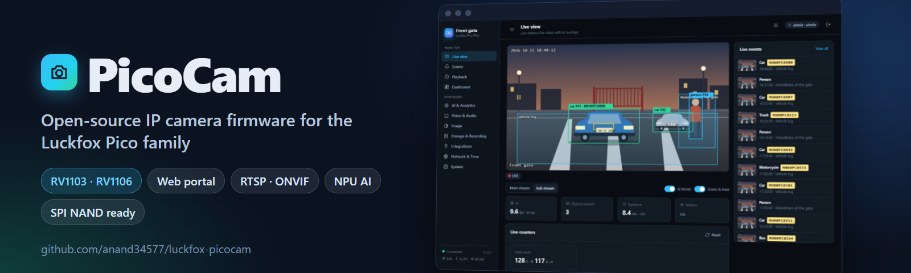
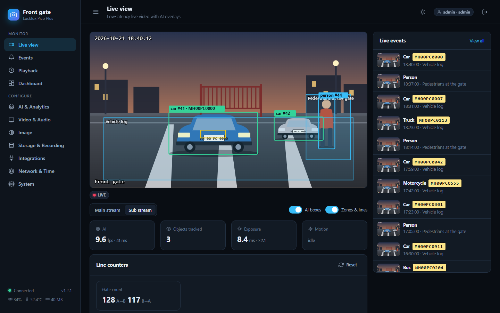
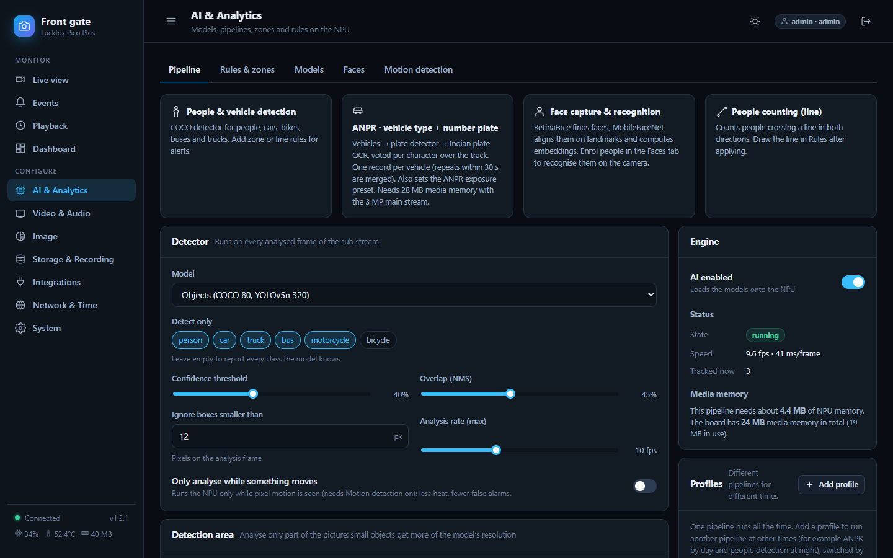
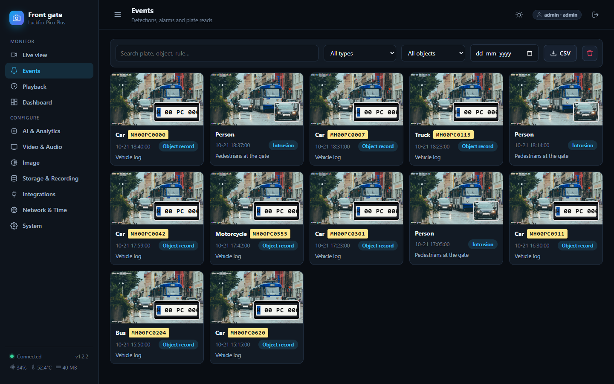
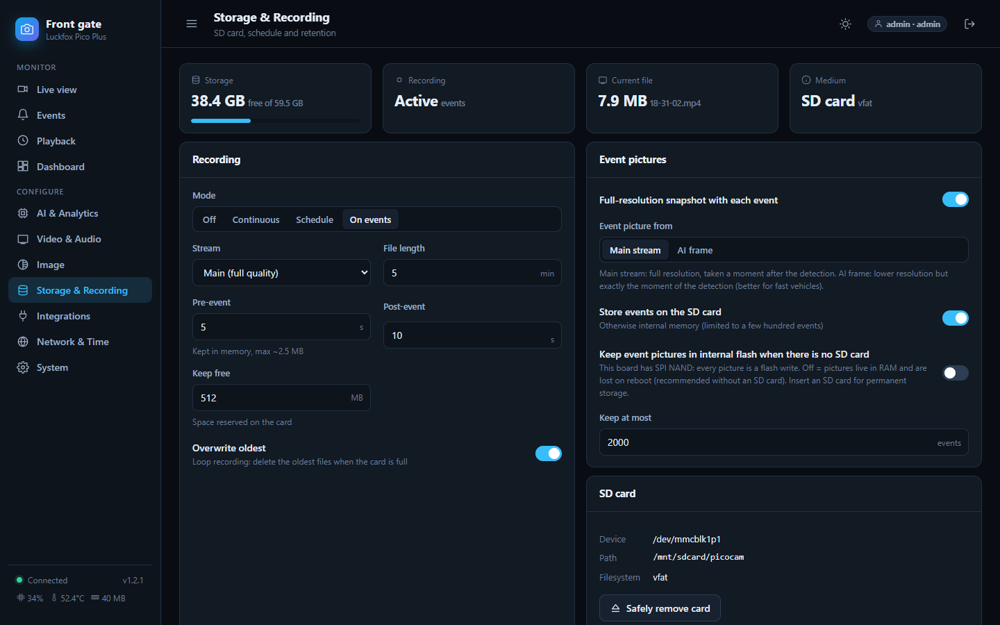
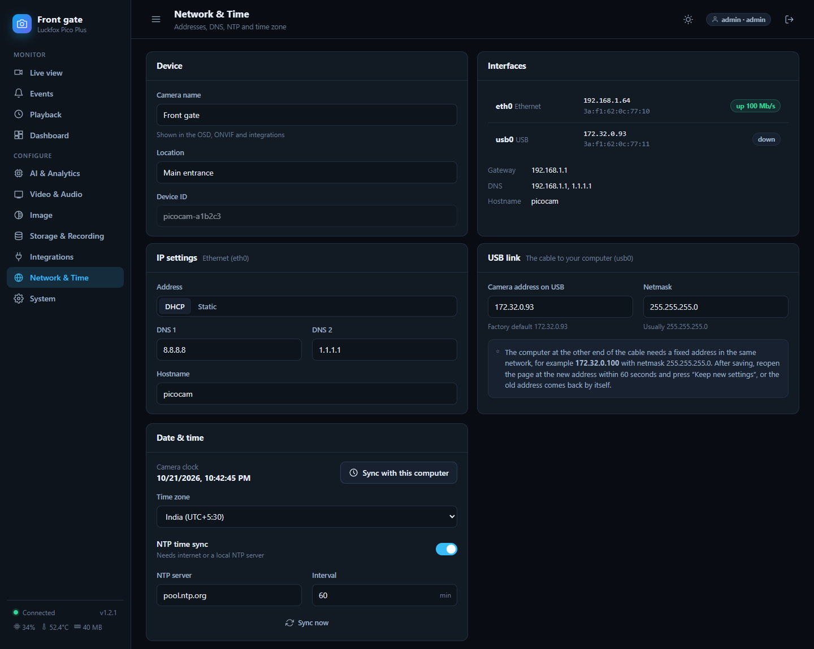

<p align="center">
  
</p>

<p align="center">
  <a href="https://github.com/anand34577/luckfox-picocam/releases/latest"></a>
  <a href="https://github.com/anand34577/luckfox-picocam/actions/workflows/ci.yml"></a>
  <a href="LICENSE"></a>
  
</p>

**PicoCam turns a Luckfox Pico board and a camera module into a complete IP camera.** It replaces the demo camera app with one small program and
a modern web page: live video, recording, motion alerts and AI that runs on the board itself (people, vehicles, number plates, faces). No cloud, no
account, no subscription.

<p align="center">
  
  <br><sub>The live view in demo mode. The street is a stock photo (Vlad Fonsark, Pexels) with fictional number plates, not footage from a PicoCam.</sub>
</p>

## What you get

- **Live view in your browser** with about 0.3 s delay, on desktop and phone, with boxes and zones drawn over the video
- **Standard streams** for any player or recorder: RTSP, ONVIF (NVRs find it), JPEG snapshots, REST API
- **AI on the camera's NPU:** people and vehicles, number plates (ANPR), face recognition, line counting, intrusion zones. Ready-made models
  included; bring your own if you like
- **Alerts where you are:** Telegram, email, webhooks, MQTT (with Home Assistant), FTP, a relay output. Events are queued and retried if the network drops
- **Recording to an SD card** by event, schedule or continuously, with a timeline player
- **Works on the whole Luckfox Pico family:** it detects your chip, memory, flash type (SPI NAND / eMMC / SD) and camera module by itself, and protects
  small flash from wear
- **Hard to break:** hardware watchdog, automatic rollback of a bad update, last-known-good settings, an install you can undo in one command

## Install in three steps

1. **Flash the standard Luckfox Buildroot image** onto your board, if it is not already on it. ([How, with every detail](docs/INSTALL.md#step-1-put-the-luckfox-buildroot-image-on-the-board))
2. **Connect it to your PC** with the USB cable (the board is then `172.32.0.93`) or an Ethernet cable. ([Details and drivers](docs/INSTALL.md#step-2-connect-the-board-to-your-pc))
3. **Run the installer.** It downloads the latest release and installs it. Password: `luckfox`.

   | Windows (PowerShell) | Linux / macOS / WSL / Git Bash |
   |---|---|
   | `.\picocam\tools\deploy.ps1` | `picocam/tools/deploy.sh` |
   | `.\picocam\tools\deploy.ps1 -Board 192.168.1.64` | `picocam/tools/deploy.sh -b 192.168.1.64` |

Then open **`http://172.32.0.93/`** (or your board's address), choose an admin password and follow the four-step wizard.
**No compiler, no Docker.** Little flash on your board? Add `-Lite` / `--lite`.
Back to the stock firmware at any time: `sh /oem/picocam/uninstall.sh && reboot`.

> The full guide, with the steps for every operating system and what to do when something does not match, is in **[docs/INSTALL.md](docs/INSTALL.md)**.

## Documentation

| | |
|---|---|
| [Install guide](docs/INSTALL.md) | Flashing, connecting, installing, first start, updating |
| [User guide](docs/USER-GUIDE.md) | Every page of the web portal with pictures |
| [Connecting other software](docs/CONNECTING.md) | VLC, NVRs, Frigate, Home Assistant, alerts, the API |
| [EdgeAI server API](docs/API.md) | REST + webhooks for faces, people, vehicles and plates, with images (OpenAPI spec included) |
| [AI models](docs/MODELS.md) | The ready-made models, adding your own |
| [Boards](docs/BOARDS.md) | Which boards, flash types, what is verified |
| [FAQ](docs/FAQ.md) | Short answers |
| [Troubleshooting](docs/TROUBLESHOOTING.md) | "It does not work": every case we know, with the fix |
| [Building from source](docs/BUILDING.md) | For developers |

The same pages are on the project's **[Wiki](https://github.com/anand34577/luckfox-picocam/wiki)**.

## Which boards?

One package serves every board. While running, the firmware detects the chip, RAM, boot flash, Ethernet/Wi-Fi and the camera module, shows them under
**System**, and sets its limits from them.

| Family | Chip | Typical |
|---|---|---|
| Pico, Pico Mini, Pico Plus ... | RV1103 | 64-128 MB RAM; Ethernet on the Plus; SPI NAND or SD |
| Pico Pro, Pico Max, Pico Ultra ... | RV1106 | 256 MB RAM; Ethernet; SPI NAND / eMMC / SD |

Verified on real hardware so far: **Luckfox Pico** and **Pico Plus** with the SC3336 3 MP module. Other boards run the same code but are not yet confirmed:
please send a [board report](https://github.com/anand34577/luckfox-picocam/issues/new?template=board-report.yml). Details: [docs/BOARDS.md](docs/BOARDS.md).

<p align="center">
  
  
  <br>
  
  
</p>

## Try the web UI without a board

```sh
cd picocam/web && npm ci && npm run build && npm run mock      # then open http://localhost:8099/
```

A pretend camera with made-up data (all screenshots in this repository come from it; the street picture is a stock photo, not PicoCam footage).

## Repository map

| Path | What |
|---|---|
| `picocam/` | firmware (C++), web portal (Preact), board scripts, installers |
| `docs/` | the documentation above |
| `models/`, `ocr/` | scripts to train and convert AI models (ONNX to RKNN) |
| `server/`, `web/` | optional EdgeAI receiver (Go) and its dashboard for collecting events from many cameras |
| `docker/` | the optional build/conversion image |

Releases are built automatically by GitHub Actions when a version tag is pushed ([`release.yml`](.github/workflows/release.yml)).

## Contributing and licence

Contributions are welcome: [CONTRIBUTING.md](CONTRIBUTING.md). The code is MIT licensed ([LICENSE](LICENSE)). Third-party components and the licence caveats
for the ready-made AI models are in [NOTICE.md](NOTICE.md). Report security problems privately: [SECURITY.md](SECURITY.md).
