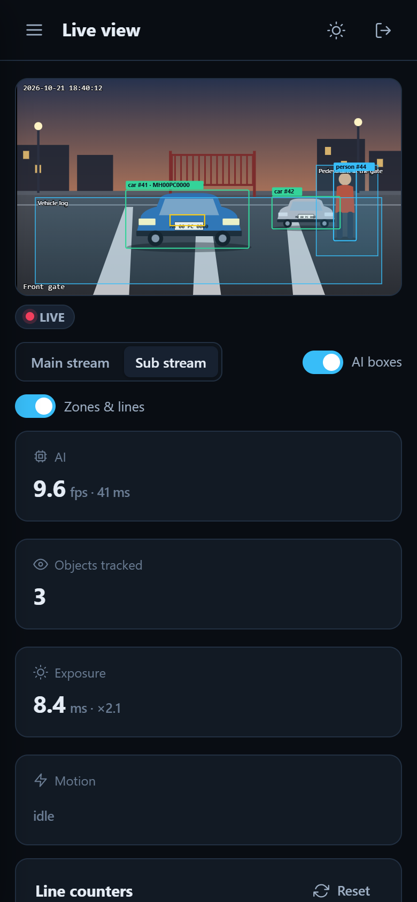
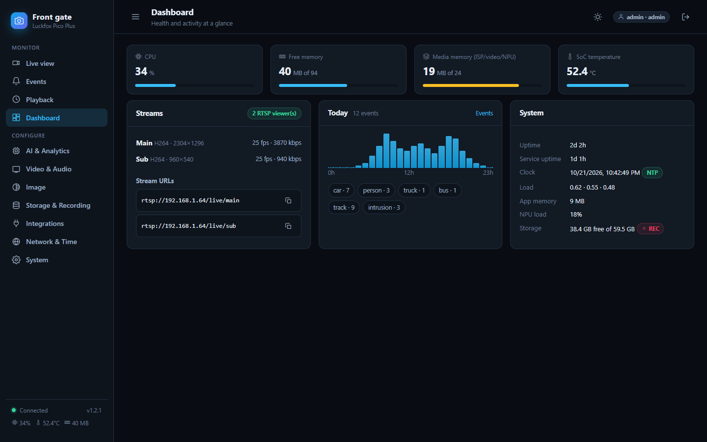
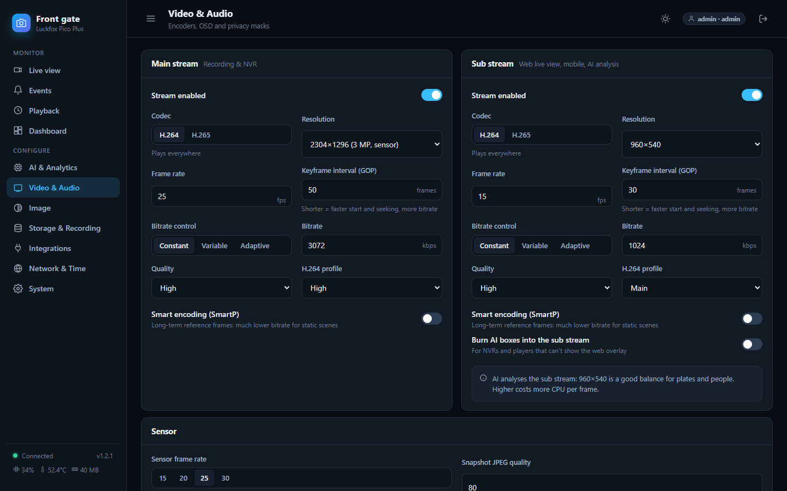
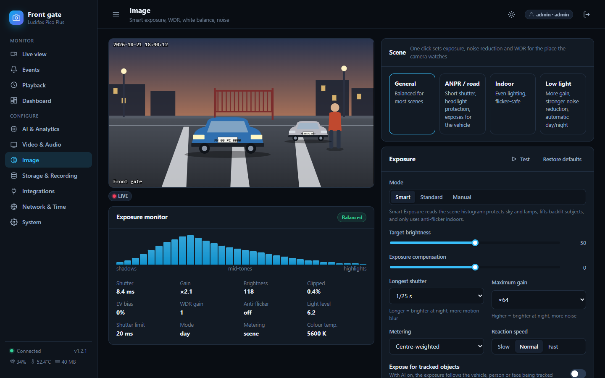
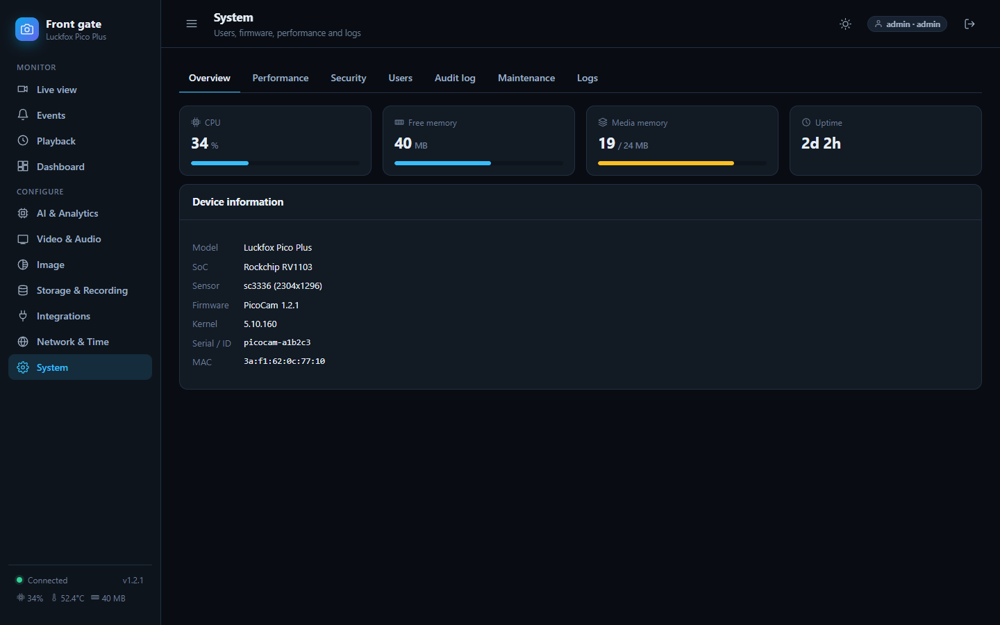
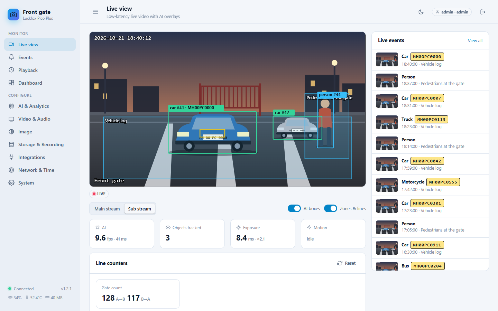

# User guide

A tour of the web portal, page by page, in the order you will probably need them. Open it at `http://<board-ip>/`.

The pictures in this guide use a made-up scene and a fictional number plate: they are drawn by the project's demo mode, not taken
from a real camera.

**Roles.** *Viewer* can watch and play back. *Operator* can also change settings and AI. *Admin* can do everything (users,
network, updates). The same accounts work for the web, RTSP and ONVIF.

---

## Live view

The picture arrives with about a third of a second delay. Boxes and coloured zones are drawn on top of it by your browser; they are
not part of the video.

- **Main / Sub stream.** Sub is lighter and plays everywhere. Main is full resolution.
- **AI boxes / Zones & lines** switch the overlays on and off.
- Under the picture the badge shows the connection state. Hover the picture for **Snapshot**, **Reconnect** and **Fullscreen**.
- The tiles show AI speed, objects tracked, exposure and motion. *Line counters* count people or cars crossing a line you draw.
- **Live events** on the right shows the latest detections. Click one to open it.

On a phone the page stacks into one column:

*The live view says "Connecting" or "Connection lost"?* The page retries every two seconds by itself. See
[Troubleshooting](TROUBLESHOOTING.md#live-view-does-not-play).

## Events

Every detection or alarm becomes an event with a picture. Search by plate, object or rule, filter by type, object or date, export to
**CSV**, or click an event to see the full picture, the crops (for example the number plate) and a link that **plays the recording**
from that moment. The red button deletes all events.

Where the pictures are kept depends on your hardware: on the SD card when there is one. Without a card, boards with SPI NAND keep
them in RAM (gone after a reboot, on purpose, to spare the flash); see [Boards](BOARDS.md#flash-types).

## Playback

Recordings from the SD card, by day, as a timeline. Pick a day, click a file or a point on the timeline. Files download as normal
MP4 files. Needs an SD card and recording switched on in *Storage & Recording*.

## Dashboard

Health at a glance: CPU, memory, **media memory** (the pool shared by the camera, encoders and AI), temperature, uptime, the stream
addresses to copy, and how many events happened today.

## AI & Analytics

Where the camera's brain is set up. Four ready-made **templates** at the top get you going in one click:

| Template | What it does |
|---|---|
| People & vehicle detection | Finds people, cars, bikes, buses and trucks. Add zone or line rules for alerts |
| ANPR (vehicle + number plate) | Vehicle, then plate, then reads the plate, voted over several frames |
| Face capture & recognition | Finds faces and recognises people you enrol under *Faces* |
| People counting (line) | Counts people crossing a line in both directions |

Tabs: **Pipeline** (detector, extra stages, speed), **Rules & zones** (draw areas and lines, choose what raises an event),
**Models** (upload your own or use the demo models; see [Models](MODELS.md)), **Faces**, **Motion detection** (works without AI).

*Media memory* on this page tells you whether the pipeline fits. If it does not, the camera keeps streaming and the page says
what to lower.

## Video & Audio

Main and sub stream: resolution (the list follows your camera module), codec (H.264 plays everywhere; H.265 halves the bitrate),
frame rate, bitrate mode and quality. **On-screen display** puts the date and name on the picture. **Privacy masks** black out up to
eight areas in every stream, snapshot and recording. There is no audio: these boards have no microphone.

> Changing video settings restarts the encoders for a moment. Viewers reconnect by themselves.

## Image

Pick the **Scene** (general, road/ANPR, indoor, low light) for a good start. **Smart Exposure** keeps highlights from clipping and lifts
backlit subjects; the monitor shows the live histogram. Below are WDR, brightness/contrast/colour, noise reduction, and day/night
(including IR-cut and IR lamp pins, which are different on every board: set the GPIO numbers for yours). Sliders apply immediately and
are saved once you stop moving them.

## Storage & Recording

Shows the SD card, free space and what is recording. Recording modes: **off**, **on events** (with seconds before and after),
**continuous**, or a **weekly schedule** painted on a grid. *Overwrite oldest* makes it loop. Recordings are fragmented MP4, so a power
cut loses at most a few seconds. Use **Safely remove** before pulling the card. **Format** (FAT32 or ext4) is offered for a card the
camera cannot read (for example exFAT).

## Integrations

RTSP, ONVIF, webhooks, MQTT (with Home Assistant discovery), Telegram, email, FTP, GPIO relay output, API keys and the EdgeAI server.
Every target has its own retry queue, so a short network outage does not lose events. [Connecting](CONNECTING.md) explains each.

## Network & Time

Camera name, interfaces and addresses, **IP settings** for Ethernet (DHCP or static), the **USB link** address, DNS, hostname,
NTP and time zone. A changed address is **confirmed or reverted**: after saving, reopen the page at the new address within 60
seconds and press *Keep new settings*; otherwise the old settings come back. That protects you from locking yourself out.

The board has no battery clock. If it has no internet, the browser sets the clock when an admin logs in, or use *Sync with this
computer*.

## System

**Overview** (versions, device details, restart/reboot, backup and restore, factory reset), **Performance** (media memory),
**Security** (watchdog, SSH and ADB switches, HTTPS certificate, IP allow-list, sessions), **Users**, **Audit log**, **Maintenance**
(firmware update and rollback, diagnostics download) and **Logs**.

---

## Light theme

The sun/moon button at the top switches themes; your browser remembers it.

## Keyboard and accessibility

Every control can be reached with the keyboard (Tab, Enter, Space). Focus is always visible. Tables rows that open something are
buttons.
